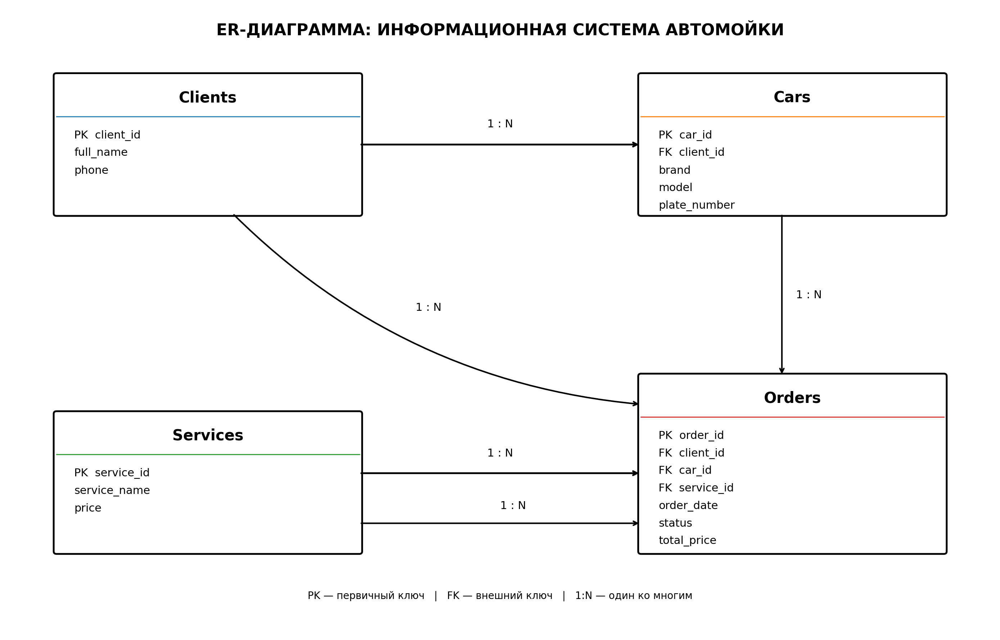

# Car Wash Management System

## Жоба туралы
Бұл жоба автомойка жұмысын басқаруға арналған ақпараттық жүйе. Жүйе клиенттерді тіркеуге, автомобильдер туралы ақпаратты сақтауға, қызметтерді таңдауға және тапсырыстарды басқаруға мүмкіндік береді.

## Жобаның мақсаты
Автомойка жұмысын автоматтандыру, клиенттерге қызмет көрсету процесін жеңілдету және тапсырыстарды тиімді басқару.

## Негізгі кестелер
1. **Clients** — клиенттер туралы ақпарат.
2. **Cars** — клиенттердің автомобильдері туралы ақпарат.
3. **Services** — автомойка қызметтері мен бағалары.
4. **Orders** — клиенттердің тапсырыстары туралы ақпарат.

## Кестелер арасындағы байланыстар
- Clients → Cars (1:N)
- Clients → Orders (1:N)
- Cars → Orders (1:N)
- Services → Orders (1:N)

## ER-диаграмма

## Қолданылатын технологиялар
- Python
- Git және GitHub
- draw.io (ER-диаграмма)

## Жоба кезеңдері
- [x] Тақырып таңдау
- [x] Негізгі кестелерді анықтау
- [x] ER-диаграмма құру
- [x] GitHub репозиторийін ашу
- [x] README.md және .gitignore қосу
- [ ] Python бағдарламасын әзірлеу

## Автор
Жаксылыков Елдос Ерболович — 2026
